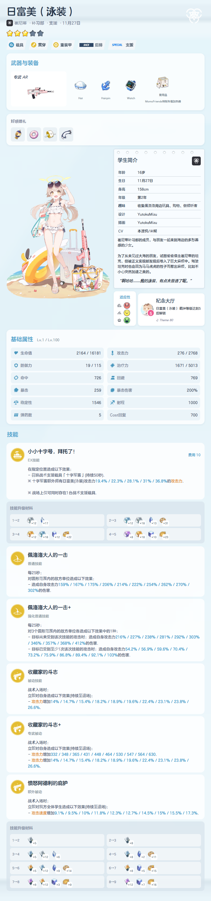
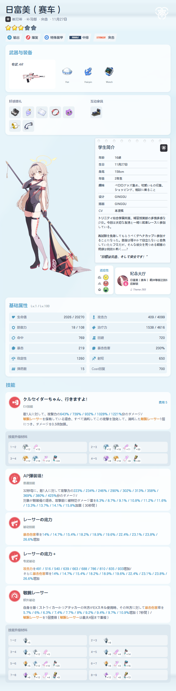
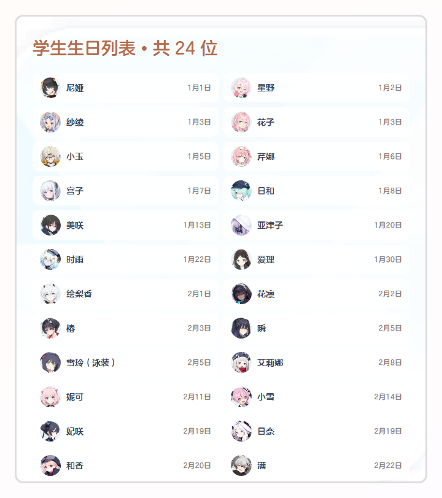
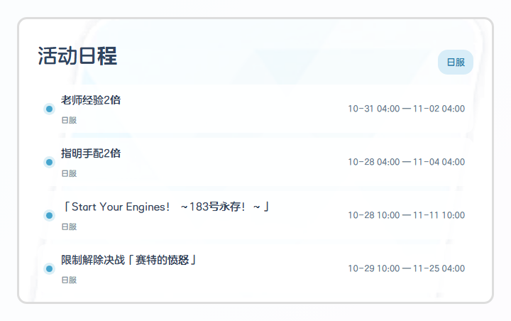
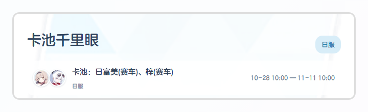
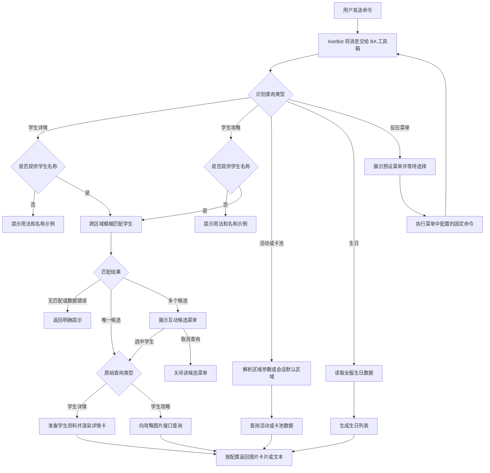
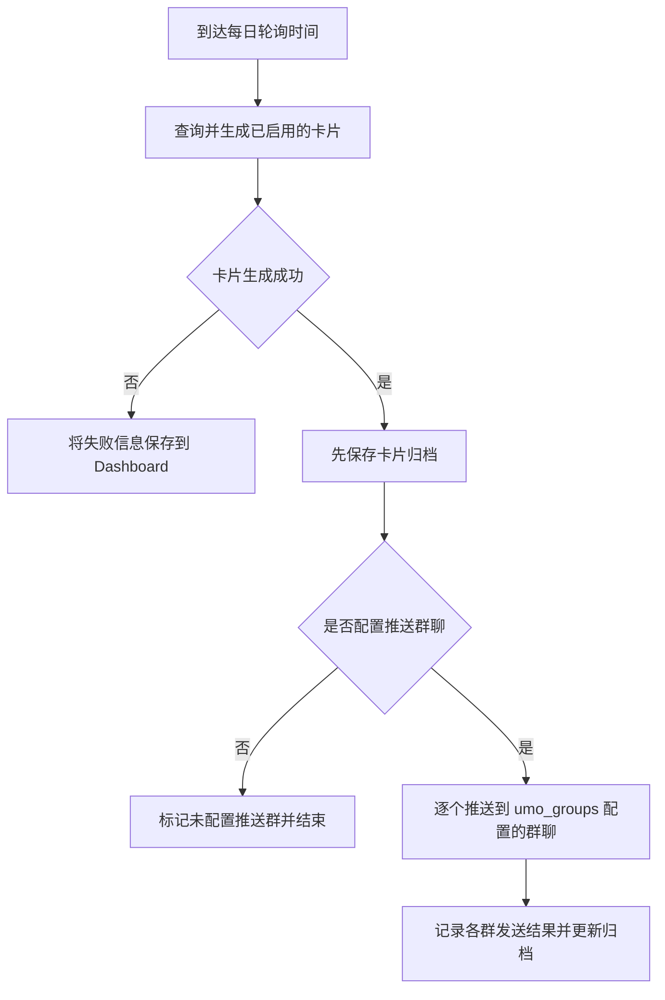

# ✨ BA 工具箱 | Blue Archive Toolbox (AstrBot Plugin)


## ✅ 简介 | Introduction

<table>
  <tr>
    <td width="190" align="center">
      
    </td>
    <td>
      <strong>碧蓝档案活动 / 千里眼 / 攻略查询工具箱</strong><br />
      学生数据查询 · 游戏信息卡片 · 每日轮询归档 · AstrBot 原生 WebUI<br />
      <sub>Blue Archive data lookup, card rendering, daily archives, and native AstrBot WebUI.</sub>
    </td>
  </tr>
</table>

**BA 工具箱**是一个为 AstrBot 开发的《碧蓝档案》信息查询与卡片渲染插件
插件整合学生静态数据、运营活动信息和攻略图片，并提供可视化设置、群聊表情回应菜单及每日轮询记录

[](https://github.com/DearCrazyLeaf/astrbot_plugin_bluearchive_toolbox/releases/latest)
[](https://www.gnu.org/licenses/gpl-3.0.txt)
[](https://github.com/DearCrazyLeaf/astrbot_plugin_bluearchive_toolbox/issues)
[](https://github.com/DearCrazyLeaf/astrbot_plugin_bluearchive_toolbox/pulls)
[](https://qm.qq.com/q/H3uUCEZKgg)
[](https://github.com/DearCrazyLeaf/astrbot_plugin_bluearchive_toolbox/stargazers)

## ✅ 功能列表 | Features

- **学生详情卡片**：查询学生资料、技能、属性、装备、适应性和立绘
- **活动日程与卡池千里眼**：查询国服、国际服、日服或全服排期，支持卡片和文本回复
- **生日列表与学生攻略**：展示全服学生生日，或查询 Arona 上的学生攻略图片
- **每日轮询与推送**：定时生成日程、生日和千里眼卡片，推送到 `umo_groups` 配置的群聊，并按日期归档卡片和各群发送结果，方便在 Dashboard 查看；没有配置群聊时只保存归档
- **表情回应菜单**：群聊中发送菜单关键词，通过表情或回复序号/菜单项执行预先配置的固定指令
- **AstrBot 原生 WebUI**：查看功能、缓存统计、轮询记录和数据来源，并管理插件设置
- **缓存与资源管理**：缓存 SchaleDB 数据、图片和生成卡片；中文完整字体可选下载，默认使用内置字体












## 🧭 插件可以干什么？ | Functions & Workflow

**简单来说，`BA 工具箱` 就是一个在 AstrBot 里查 `《碧蓝档案》` 信息的小帮手**

- 你可以直接在聊天里查`学生资料`、`活动日程`、`卡池千里眼`、`生日`和`学生攻略`，也可以按`国服`、`国际服`或`日服`筛选`活动`和`卡池信息`；查到的内容会按配置用图片卡片或文字发回来

- 平时不想记太多指令，也可以用表情回应菜单快速触发预先配置好的查询；管理员还能设置定时任务，把信息卡片推送到配置的群聊，并在插件 `Dashboard` 里查看卡片和发送记录

> 定时轮询会把生成的卡片推送到 `umo_groups` 配置的群聊，同时保存卡片和每个群的发送结果，之后可以在 `Dashboard` 查看

### 一次查询会经过哪些步骤？

**大致流程如下**：

直接查询时：发出指令 -> 插件识别查询类型 -> 查询数据 -> 返回结果

> 学生详情和攻略需要带上学生名称，如果没写名称，插件会提示你怎么输入，不会自动等你发送下一条消息



### 定时轮询和推送

每天到设定时间后，插件会生成已启用的卡片，按 `umo_groups` 配置推送到群聊，并把卡片和发送结果保存到 Dashboard



1. 发送查询指令，可以使用默认指令或自己配置的触发词，也可以在前面加 `/`
2. 查学生详情或攻略时，带上学生名字；只发指令的话，插件会给出输入示例
3. 插件会到 SchaleDB 的国服、国际服和日服数据里模糊搜索，并按学生 ID 合并结果；资料优先用国服，其次国际服，最后日服，显示名称则按语言设置选择
4. 只找到一个学生时，详情指令会生成资料卡，攻略指令会把学生名称交给攻略图片接口查询
5. 找到多个学生时，会出现候选菜单供选择；菜单可以继续使用，点取消则立即关闭；群内成员都能点表情选择，发起查询的人也可以回复菜单输入序号或名称
6. 查活动或卡池时，可以指定服务器区域；没指定就按会话配置和默认区域查询，生日列表则是全服通用
7. 查询结果会按消息模式发送图片、文字或两者；定时轮询生成的卡片会推送到 `umo_groups` 配置的群聊，并将卡片及每个群的发送结果存档到 Dashboard

### 接下来想做什么？

下面这些还在规划中，目前版本还没有提供这些功能（主要看目前使用的API支不支持相关查询）

- [ ] 给不带名称的学生详情和攻略指令加一个互动向导，让你可以先选查询类型，再输入名称
- [ ] 研究 Boss 资料查询，先确认数据从哪里来、有哪些字段，再设计单独的 Boss 信息卡片
- [ ] 查清攻略图片接口是否支持 Boss 或关卡，确认支持后再考虑加入菜单
- [ ] 为互动向导补上独立会话、发起者权限、并发限制、超时、取消和异常处理，并补齐自动化测试

### 已经做好的内容

| 版本 | 做了什么 |
| --- | --- |
| `v1.0.0` | 建立学生详情、生日、活动日程、卡池千里眼和学生攻略查询能力；接入 SchaleDB、GameKee 与攻略图片服务；提供区域查询、互动菜单、定时归档、Dashboard 和资源缓存 |
| `v1.0.1` | 完善学生模糊搜索及跨区域候选优先级；增加可复用、可取消的互动候选菜单及有效期/并发配置；修复菜单路由和表情映射问题；将同步卡片渲染移至工作线程，并在启动时检测/安装 Playwright Chromium |

## 📥 安装 | Installation

在 AstrBot 插件市场搜索“BA 工具箱”安装，或在 AstrBot 的 `data/plugins` 目录克隆仓库：

```bash
cd /AstrBot/data/plugins
git clone https://github.com/DearCrazyLeaf/astrbot_plugin_bluearchive_toolbox
```

>[!NOTE]
>首次启动时插件会检查 Playwright Chromium；若缺失则自动下载并安装下载失败会在 AstrBot 后台日志中给出原因和手动安装命令；安装需要网络连接和浏览器缓存目录的写入权限，可能会延长首次启动时间

## ⚙️ 配置 | Configuration

配置入口：

```text
AstrBot WebUI -> 插件 -> BA 工具箱 -> 插件配置
```

插件 Dashboard 中也可编辑、保存本插件设置

| 配置项 | 说明 |
| --- | --- |
| `message_mode` | 回复方式：`card`（默认）、`text` 或 `mixed` |
| `server_region` | 活动/卡池默认区域：`cn`、`global`、`jp` 或 `all` |
| `student_data_language` | 学生详情及生日列表的名称/文本语言；留空时按会话区域或默认语言处理 |
| `umo_groups` | 每行填写一个群聊，格式为 `平台名:GroupMessage:群号:区域`，例如 `aiocqhttp:GroupMessage:123456:jp`；可填写多行推送到多个群，末尾区域同时作为该群活动/卡池的默认区域，支持 `cn`、`global`、`jp`、`all`；留空不会向任何群推送，但仍会生成卡片并保存到 Dashboard |
| `menu_settings` | 菜单关键词、有效期、防抖、表情池和菜单项；菜单项支持 `label`、`command`、`face_id` |
| `polling_settings` | 轮询开关、执行时间、服务器、类别和归档保留天数；卡片推送到 `umo_groups` 中的群聊，执行时间使用 AstrBot 主机本地时区 |
| `cache_settings` | 控制生成卡片图片缓存的数量、容量和过期时间；SchaleDB 缓存单独管理 |
| `download_full_font` | 是否下载完整中文字体；默认关闭，使用随插件附带的精简字体 |
| `schaledb_base_url` | SchaleDB 兼容镜像根地址；留空使用默认站点 |
| `api_base_url` | GameKee 兼容镜像根地址；留空使用默认站点 |

- 默认每日 08:00 轮询全服日程、生日和千里眼，保留 30 天

- 轮询记录和卡片存放在 AstrBot 分配给插件的数据目录中，与普通卡片缓存分开

## 📖 使用说明 | Usage

普通查询指令可直接发送，也支持 `/` 前缀

默认触发词可在插件配置中修改

| 功能 | 命令示例 |
| --- | --- |
| 学生详情 | `学生 日富美`、`学生 日富美（赛车）` |
| 学生攻略 | `攻略 日富美`、`攻略 日富美（赛车）` |
| 活动日程 | `活动`、`活动 jp`、`活动 all` |
| 卡池千里眼 | `卡池`、`卡池 global`、`卡池 all` |
| 全服生日 | `生日` |

- 学生详情与攻略支持输入部分学生名称进行模糊匹配；不带名称时会提示用法和输入示例

- 详情查询生成学生资料卡，攻略查询先从 SchaleDB 匹配学生，再将选中的名称交给现有攻略图片接口查询

- 详情或攻略名称匹配到多个候选时，群聊会显示互动候选菜单；群内任何人都可点击表情查询候选，查询发起者可回复对应菜单并输入序号/候选名称；选择候选后菜单继续有效，可重复选择；点击“取消查询”后关闭

- 学生候选菜单可在 `student_choice_settings` 单独配置有效期、每群并发上限和专用表情池；默认有效 120 秒、每群最多 3 个；达到上限时保留现有菜单并拒绝创建新菜单

- 学生候选会搜索国服、国际服和日服数据并按学生 ID 去重；资料优先使用国服记录，其次国际服，最后日服；名称和文本按 `student_data_language` 显示，缺少该语言记录时回退到可用语言

- 活动和卡池的区域参数支持 `cn`、`global`、`jp`、`all`

- 未指定区域时，插件优先使用当前会话在 `umo_groups` 中配置的区域，再使用 `server_region`

- 参数 `all` 会分别查询三个服务器并标注来源

- 生日数据为全服通用，不接受区域参数

---

### 表情回应菜单

在群聊发送配置的菜单关键词（默认 `菜单` 或 `ba菜单`）打开菜单

- 菜单项执行固定命令，不支持点击后继续输入参数；学生详情/攻略菜单项应填写完整指令，例如：

```text
学生详情 | 学生 日富美
学生攻略 | 攻略 日富美（赛车）
```

- 菜单项可配置 `face_id` 覆盖自动分配的表情 ID

- 每条菜单指令在配置时即确定，不会自动选择“最新攻略集”或按当前服务器追加查询参数

## 🛠️ 问题排查 | Troubleshooting

- **卡片渲染失败**：确认 AstrBot 运行环境可访问网络并能写入 Playwright 浏览器缓存目录；插件会在启动时自动检测并安装 Chromium，失败原因会记录在后台日志中
- **查询数据失败**：确认运行环境可访问相应数据源；需要镜像时，在插件配置中填写 `api_base_url` 或 `schaledb_base_url`
- **学生名称未匹配**：详情和攻略查询会跨国服、国际服和日服数据搜索；可输入部分名称，或尝试版本名，例如 `日富美（赛车）` 出现多个候选时，群内任何人都可点击候选表情查询；发起者也可回复对应候选菜单输入序号；每群并发上限和过期时间可在 `student_choice_settings` 配置
- **中文字符显示不全**：默认使用精简字体；可启用 `download_full_font` 让插件尝试下载完整字体；无法访问上游时可关闭该选项并使用内置字体

## 🤝 开发构建 | Development  

本地离线测试：

```bash
python -m unittest discover -s tests
```

- 目录 `tests/` 包含单元测试；`test/render_test.py` 是手动真实 API 出图脚本，需要可用网络和 Playwright Chromium，生成图片及临时缓存位于 `test/output/`

## ❤️ 贡献者 | Contributors

<a href="https://github.com/DearCrazyLeaf/astrbot_plugin_bluearchive_toolbox/graphs/contributors">
  
</a>

## 🙏 致谢 | Acknowledgements

### 数据来源

| 数据 | 来源 |
| --- | --- |
| 学生资料、生日及学生资源图片 | [SchaleDB](https://schaledb.com/) |
| 活动日程与卡池 | [GameKee](https://www.gamekee.com/) |
| 学生攻略图片 | [Arona](https://arona.diyigemt.com/) |

- 学生候选跨 SchaleDB 国服、国际服和日服数据搜索并按 ID 去重；学生资料按国服、国际服、日服顺序回退，显示语言按插件配置优先，并回退到该学生实际可用的语言记录

- 学生立绘、头像、武器和物品图标按需下载并缓存

- GameKee 和 Arona 查询结果不会在插件内持久缓存

---

### 素材与灵感

- [BlueArchiveUI · ywhdzrb](https://github.com/ywhdzrb/BlueArchiveUI)：参考第三方 Qt6 UI 组件与视觉风格
- [奇怪的蔚蓝档案资料库 · RedBeanN](https://github.com/RedBeanN/BlueArchive)：参考游戏数据资源，并提供完整中文字体下载来源
- [蔚蓝档案攻略查询 · nicocatxzc](https://github.com/nicocatxzc/astrbot-plugin-BlueArchive)：指令式攻略、活动与卡池查询组织，以及 GameKee 图文获取和失败回退思路
- [学生生日提醒 · laopanmemz](https://github.com/laopanmemz/astrbot_plugin_babirthday)：生日列表、学生数据更新和生日提醒交互设计灵感
- [攻略查询 · anka](https://github.com/anka-afk/astrbot_plugin_blue_archive)：Arona 攻略图片查询及基于资源哈希复用本地图片缓存的思路
- [活动日历 · AyaseNIA](https://github.com/AyaseWNA/astrbot_plugin_blue_archive_auto_calendar)：多服务器活动日历、会话区域选择和定时任务设计灵感

> [!IMPORTANT]
> Dashboard 欢迎卡片使用透明动画 WebP 展示阿洛娜与普拉娜，不加载 Spine runtime、场景背景模型或 WebGL
> 角色模型素材参考 Steam 创意工坊的[原始模型](https://steamcommunity.com/sharedfiles/filedetails/?id=2959252463)及[中文版本](https://steamcommunity.com/sharedfiles/filedetails/?id=3655252545)
> 游戏及角色相关权利归各自权利人所有；本项目为非商业同人项目

---

> Made for AstrBot ❤️
